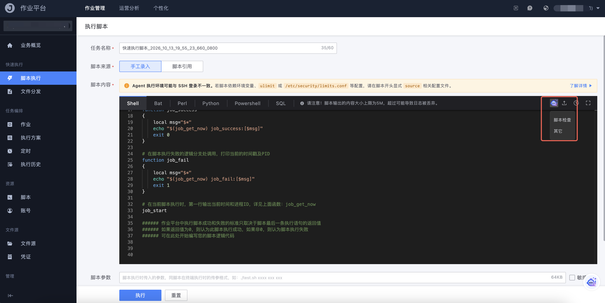
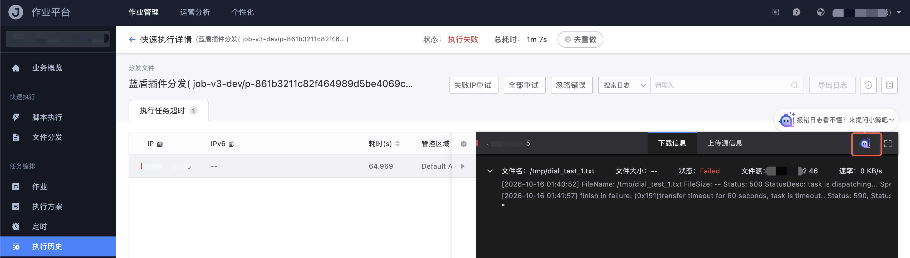

# AI 小鲸

AI 小鲸是作业平台内置的智能助手，用来辅助检查脚本、分析失败任务的报错原因。它不是独立菜单，而是嵌在脚本编辑器和执行结果页中；管理员关闭该能力后，页面不会展示入口。

## 脚本检查

在脚本编辑器（手工录入脚本、脚本版本编辑）右上角可看到小鲸入口，提供：

- **脚本检查**：结合当前脚本内容和系统内置脚本模板，检查语法或逻辑问题，并给出修改建议
- **其它**：打开通用对话，用于询问脚本编写、作业平台使用等问题

检查完成后，小鲸会询问是否按建议重新给出一版脚本内容。系统内置的初始化脚本片段不作为问题指出。

## 失败任务分析

在脚本执行或文件分发的步骤结果页，当任务未成功时，可点击小鲸分析报错：

- 脚本任务：结合脚本内容、脚本参数和报错日志，说明主要原因并给出处理建议
- 文件分发任务：结合预分析结果（失败来源、上传/下载失败机器）给出总结性原因与处理建议

执行成功的任务不再展示小鲸入口。

日志文本过长、超出解析范围时，需要先框选部分日志再发起分析。

## 使用注意

- AI 小鲸依赖平台侧的模型服务配置，未开通时入口不会出现
- 它给出的是辅助建议，不能替代高危语句检测；高危规则仍按「扫描 / 拦截」生效
- 涉及 GSE Agent、网络或底层管控问题时，需要结合管控平台继续排查
