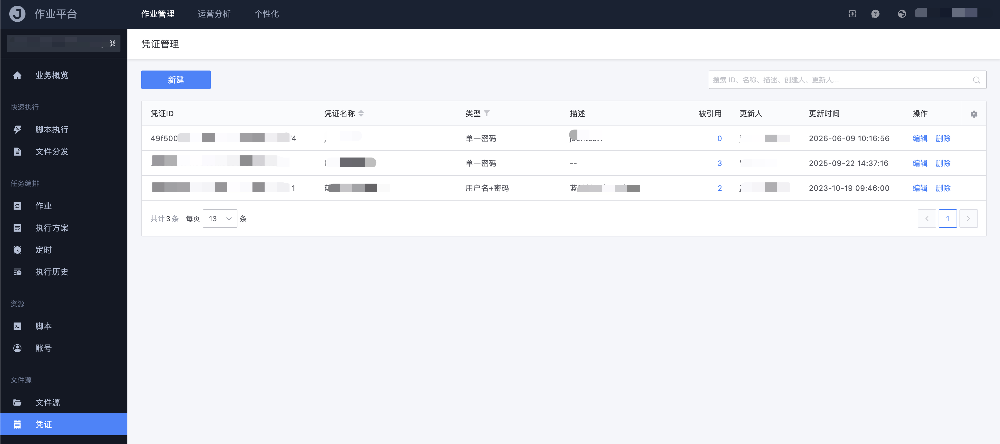
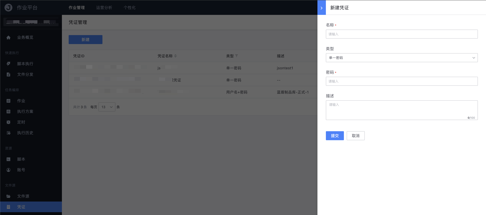

# 凭证

凭证用于保存访问文件源所需的身份信息，由文件源引用。凭证本身不直接参与脚本执行或文件传输，只作为文件源的鉴权材料。

路径：作业管理 → 文件源 → 凭证。该菜单与文件源一起受 `fileManage` 特性开关控制。

## 凭证列表

列表展示凭证 ID、名称、类型、描述、创建人、更新人等。可按 ID、名称、描述、创建人、更新人搜索。

## 新建凭证

点击「**新建**」创建凭证：

- 名称

  凭证的显示名称

- 类型

  - `单一密码`
  - `用户名+密码`
  - `单一 SecretKey`
  - `AppID+SecretKey`

- 凭证明文

  按类型填写对应字段。提交时由前端加密后传输，页面不会回显明文

- 描述

  可选，备注该凭证的适用存储或使用场景

## 使用注意

- 新建文件源时必须选择一张有「使用」权限的凭证
- 修改凭证内容后，引用该凭证的文件源会使用新的鉴权信息
- 删除凭证前，请确认没有文件源仍在引用
