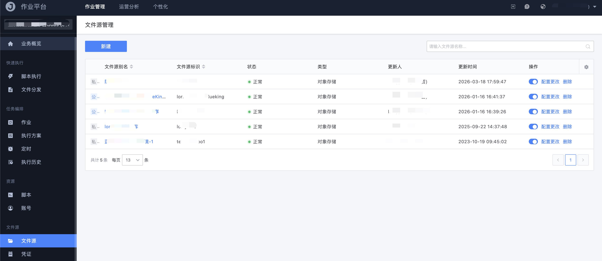
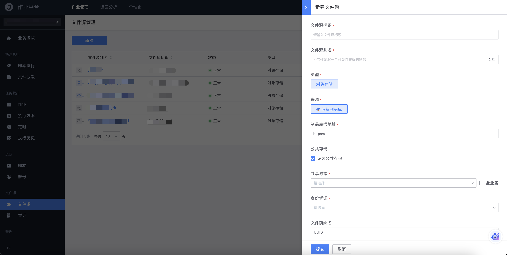

# 文件源

文件源用于把对象存储等第三方存储接入作业平台，使文件分发可以直接选择远端文件，而不必先上传到跳板机或本地。

容器化部署默认开启该能力；二进制部署需要打开 `job.features.fileManage` 特性开关后，左侧才会出现「文件源」菜单。

## 文件源列表

路径：作业管理 → 文件源 → 文件源。

列表展示文件源别名、标识、状态、类型、更新人等信息。状态异常（例如接入点不可用）时，别名不可点击进入文件浏览。

设为公共存储的文件源会在列表中带有公共标识，可按配置共享给指定业务或全业务。

## 新建文件源

点击「**新建**」创建文件源，主要字段如下：

- 文件源标识

  文件源的唯一标识，创建后用于系统和 API 引用

- 文件源别名

  面向用户的可读名称，长度不超过 32 个字符

- 类型

  当前支持 `对象存储`

- 来源

  选择平台已接入的对象存储实现（由后台文件源类型列表动态给出）

- 来源参数

  随所选来源变化，按页面提示填写桶、地域、访问地址等

- 公共存储

  勾选后可将该文件源共享给其他业务；共享对象可多选业务，也可勾选「全业务」

- 身份凭证

  必填。选择已在「凭证」中创建、且当前用户有权使用的凭证

- 文件前缀名

  可选 UUID 或自定义字符串，用于避免同名文件冲突

- 接入点

  选择 File-Worker 接入点范围；可勾选「自动选择接入点」，或手工指定某个 Worker

## 浏览文件

点击可用的文件源别名，进入该文件源的目录浏览页，支持按路径层级进入、按关键字搜索。文件分发步骤中选择「文件源文件」时，也是在此结构上勾选文件。

## 与文件分发的关系

在快速文件分发或作业文件步骤中，源文件除「本地文件」「服务器文件」外，可选择「文件源文件」。分发时由文件网关调度接入点下载，再交给执行引擎传输到目标。
