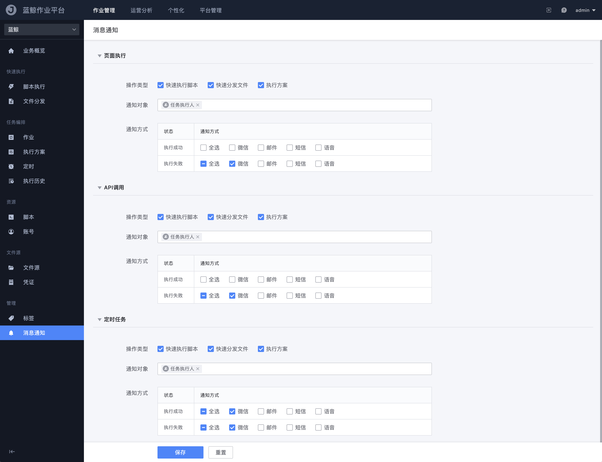

# 消息通知

消息通知设置功能帮助用户能够更及时的掌握任务的执行状态，支持根据不同的任务类型选择不同的通知方式给到特定的对象。

- 操作渠道有 `页面执行` `API 调用` `定时任务` 三种
- 通知的配置是按个人维度保存的
- 通知对象可选择作业平台内置的角色（如`任务执行人`）和业务自身的角色（如 `业务运维` `开发人员`）
- 通知对象的人员选择受 `全局设置` 中的通讯黑名单限制
- 通知方式的渠道来自于 `全局设置` 的设置
- 平台可按业务限制消息发送数量；超出当日配额后，当次通知会失败并提示配额不足
- 定时任务可以不走本页配置，改为任务级自定义通知，见 [定时](Crons.md)