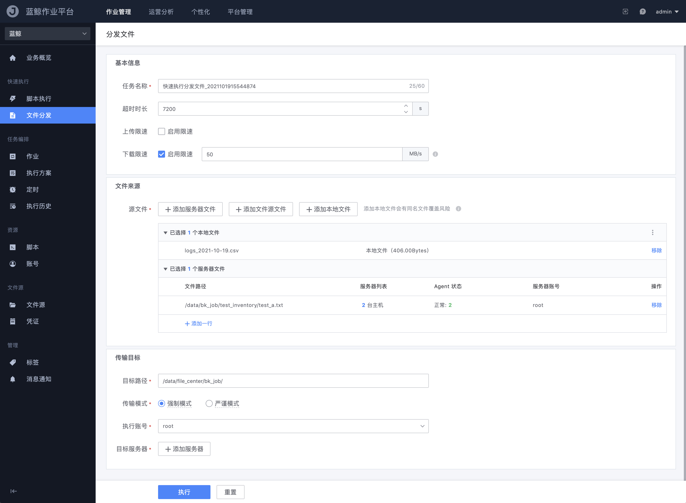
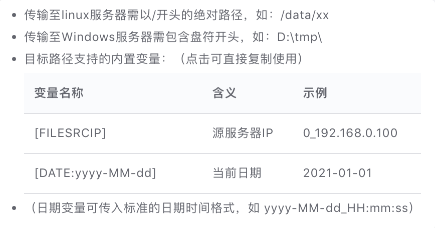
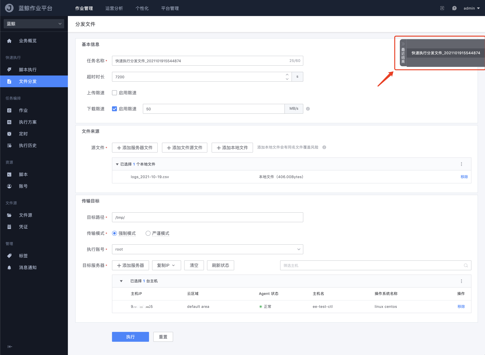

# 快速分发文件

与「快速执行脚本」功能提供的使用场景相同，快速分发文件的目的也是为了让需要进行一次性传输文件的用户，可以在这里快速的执行并得到结果。

- 任务名称

  分发文件的任务名，方便后续在执行历史中有迹可循

- 超时时长

  分发文件的超时设置，当文件传输时间超过时将会自动关闭，结果被视为 "执行超时"。未填写时默认 7200 秒；允许范围最小 1 秒，最大 259200 秒，具体上限可由管理员按业务配置。

- 上传 / 下载限速

  由于蓝鲸管控平台 Agent 默认的配置是会根据服务器带宽和资源使用情况进行限制的，防止出现因为执行的任务导致拖垮业务的机器；所以当用户自己确认机器允许更大限度传输时，通过开启限速设置可以提高传输的速率

- 源文件

  分发的源文件选择，支持：

  - `本地文件`：从当前浏览器上传。容器化环境也支持使用集群外已安装 Agent 的机器作为本地分发源
  - `服务器文件/目录`：从已纳管主机上选择
  - `文件源文件`：从已接入的对象存储文件源中选择（需开启文件源特性，见 [文件源](File-source.md)）

- 目标路径

  文件分发到目标服务器的绝对路径地址，提供了 2 种内置的变量可用：

  

- 传输模式

  > `强制模式`：不论目标路径是否存在，都将强制按照用户指定的目标路径进行传输（不存在会自动创建）
  >
  > `严谨模式`：严谨判断目标路径是否存在，若不存在将直接终止任务
  
- 执行账号

  文件分发的目标服务器相关的账号，如 Linux 系统的 `root` 或者 Windows 系统的 `system` / `Administrator`。作业步骤中也可以引用「执行账号」变量。

- 目标服务器

  从蓝鲸配置平台中获取执行对象，支持通过 `静态-IP 选择` `动态-拓扑选择` `动态-分组选择` 和 `手动输入 IP / Host ID` 的方式选择主机，也可以选择容器。选择器支持复制 Host ID、云区域:IP；选中业务下全部节点时会弹出警告确认。

- 滚动执行

  可按 `传输目标` 或 `源文件` 分批滚动，详见 [滚动执行](Rolling-execute.md)。

- 超时时长

  允许范围最小 1 秒，最大 259200 秒；未填写时默认 7200 秒。平台可按业务限制最大超时时间。

同样的，为了满足需要反复传输文件的使用场景，页面上提供了快捷查看近 5 次文件分发记录的功能：

