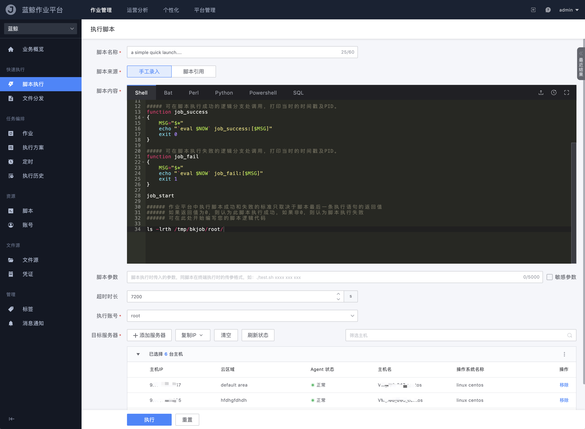
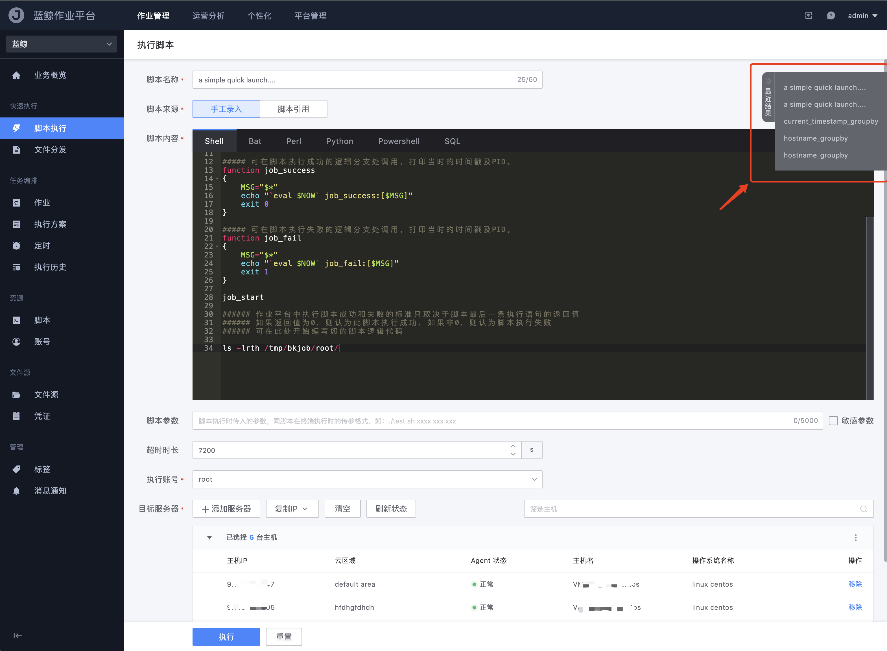

# 快速执行脚本

快速执行脚本提供的使用场景是针对需要快速执行的一次性任务，并且可能会反复调整脚本逻辑来执行得到用户想知道的结果，类似于在终端跳板机 Console 执行的效果。

- 任务名称

  本次脚本执行的任务名称，方便后续在执行历史中有迹可循

- 脚本来源

  可以通过两种方式来提供本次执行的脚本内容： `手工录入` 和 `脚本引用` 

  - 「手工录入」即用户直接在当前页面的脚本编辑器内写脚本内容
    - 脚本编辑器为 Monaco，右上角提供 `本地上传` `历史缓存` `全屏展示` 以及 [AI 小鲸](AI-assistant.md) 入口
  - 「脚本引用」则是支持从脚本管理或公共脚本库中，引用已有的脚本来执行
    - 引用的脚本内容不可编辑

- 脚本内容

  展示当前手工录入或引用的脚本内容区域，支持的脚本语言有：`Shell` `Bat` `Perl` `Python` `Powershell` `SQL`。脚本编辑器为 Monaco，支持搜索；编辑器内可使用 [AI 小鲸](AI-assistant.md) 做脚本检查。

- 解释器（Windows）

  当脚本类型不是 Shell / SQL 时，可勾选「自定义 windows 解释器路径」，填写目标机上的 `.exe` 绝对路径（如 `D:\Software\python3\python.exe`），不要带命令行选项。该选项仅对 Windows 生效；若目标中同时包含 Linux 主机，Linux 侧仍使用系统默认解释器。

- 脚本参数

  脚本执行时传入的参数，同脚本在终端执行时的传参格式，如：`./test.sh xxxx xxx xxx`

  `敏感参数` 功能支持将脚本参数屏蔽，在参数信息较敏感时，该选项就派上了用场。

- 超时时长

  本次脚本执行的超时设置，当脚本执行超过该时间后将会自动关闭，结果被视为 "执行超时"。允许范围最小 1 秒，最大 259200 秒（72 小时）；未填写时默认 7200 秒。平台可按业务限制最大超时时间。

- 执行账号

  选择脚本执行的目标服务器相关的账号，如 Linux 系统的 `root` 或者 Windows 系统的 `system` / `Administrator`

- 解释器（仅 Windows）

  脚本类型不是 Shell 或 SQL 时，可勾选「自定义 windows 解释器路径」，填写目标机上的 `.exe` 绝对路径（如 `D:\Software\python3\python.exe`），不要带命令行选项。该设置只对 Windows 生效；目标中若包含 Linux 主机，Linux 侧仍按原解释器运行。

- 目标服务器

  从蓝鲸配置平台中获取执行对象，支持通过 `拓扑选择 IP` `手动输入 IP / Host ID` `拓扑选择节点` 和 `动态分组` 的方式选择主机，也可以切换到容器（见 [容器执行](container-execute.md)）。选择器支持复制 Host ID、云区域:IP；选中业务下全部节点时会弹出警告确认。执行类操作可按拓扑节点申请权限，见 [执行类操作如何按拓扑节点申请权限](../FAQs/how-to-apply-permission-by-topo-node.md)。

为了能够满足需要反复调参执行的使用场景，页面上还提供了快捷查看近 5 次执行记录的功能：

