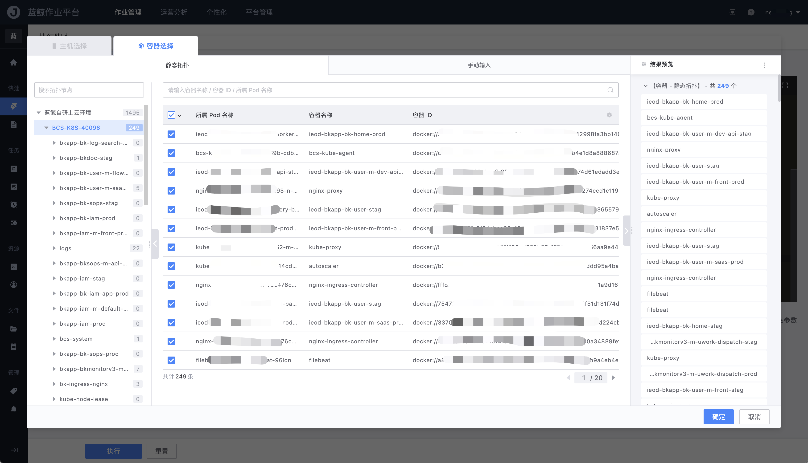
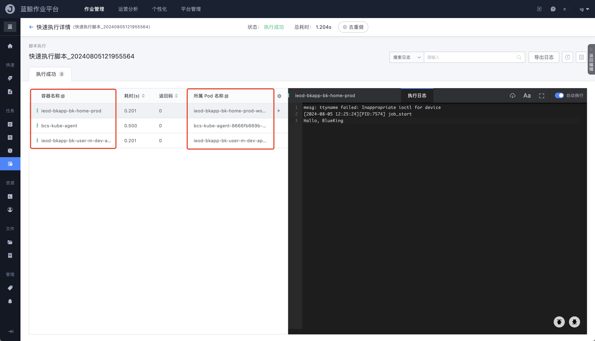

# 容器执行

作业平台支持在部署了 GSE 的容器集群节点上对 Container 进行脚本执行和文件分发。3.9 起快速执行已支持容器；3.12 起作业模板、执行方案中的脚本 / 文件步骤同样可以选择容器作为执行目标。

用户按蓝鲸容器管理平台（BCS）的拓扑选择：`Cluster - Namespace - Workload - Pod - Container`。

## 可选的 Workload

除常见工作负载外，还支持选择 CRD（Custom Resource）：

- Deployment
- StatefulSet
- DaemonSet
- CronJob
- Job
- **CRD / 自定义资源**，包含 GameStatefulSet、GameDeployment 等在配置平台中纳管的自定义工作负载

也可以按容器属性过滤（如容器名、UID），或在选择器中复制容器 ID。

## 使用入口

- 快速执行脚本 / 快速文件分发：目标选择器切换到容器
- 作业模板、执行方案的脚本步骤和文件步骤：执行目标同样可选容器
- 全局变量类型「执行目标」：可保存一批容器，供多个步骤复用

业务集、租户集范围下不支持选择容器。

该能力受 `job.features.containerExecution` 控制，未开启时选择器不会出现容器页。

## 执行结果

容器的执行结果页会展示 Container 所属的 Pod、集群、命名空间等信息，便于定位执行对象。选择器中也可复制容器 ID。

